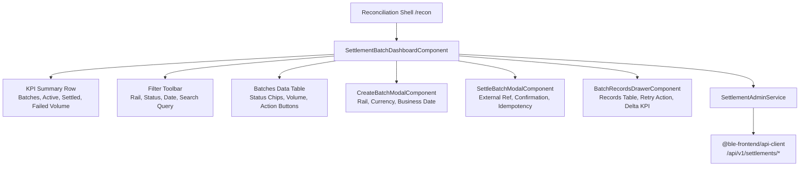

# Sprint 5 Task 2 (S5-T2): Settlement Batch Dashboard Implementation Plan

> **Back-Office Console: Settlement & Reconciliation (FR-OPS-RECON-01)**  
> **Target App:** `apps/admin-console` (Angular 19 Standalone, Signals, Zoneless)  
> **Route:** `/recon` (with tab `batches`) and `/settlements`

---

## 1. Goal Description

Implement the **Settlement Batch Dashboard** (FR-OPS-RECON-01) in `apps/admin-console`, empowering back-office bank operators and administrators to:
1. **Monitor clearing and settlement batches:** Real-time visibility into clearing batches across payment rails (`SEPA`, `ACH`, `FEDWIRE`, `SWIFT`, `FAWRY`), currencies, and business dates.
2. **Inspect batch totals & balances:** High-density breakdown displaying gross debit, gross credit, net settlement delta, record count, and batch lifecycle status (`OPEN`, `PENDING`, `SETTLED`, `FAILED`, `CLOSED`).
3. **Execute atomic batch settlement:** Operator trigger for executing batch settlement (`POST /api/v1/settlements/batches/{id}/settle`) with external clearing reference (`externalBatchReference`) and client idempotency (`BR-F03`).
4. **Inspect individual batch items:** Slide-over drawer / inspector showing all records in a batch (`GET /api/v1/settlements/batches/{id}/records`) with transaction references, timestamps, failure reasons, and retry execution (`POST /api/v1/settlements/records/{id}/retry`).
5. **Create manual batches & handle lifecycle:** Modal for initiating new clearing batches (`POST /api/v1/settlements/batches`), marking failed batches (`POST /api/v1/settlements/batches/{id}/fail`), and closing completed batches (`POST /api/v1/settlements/batches/{id}/close`).

---

## 2. User Review Required

> [!IMPORTANT]
> **API Path & Endpoint Alignment:**  
> In `libs/api-client`, the backend OpenAPI contract generates:
> - `GET /api/v1/settlements/batches` (`listBatches({ rail?, status? })`)
> - `POST /api/v1/settlements/batches` (`createBatch({ requestBody })`)
> - `GET /api/v1/settlements/batches/{batchId}` (`getBatch({ batchId })`)
> - `POST /api/v1/settlements/batches/{batchId}/settle` (`settleBatch({ batchId, requestBody })`)
> - `POST /api/v1/settlements/batches/{batchId}/fail` (`failBatch({ batchId, requestBody })`)
> - `POST /api/v1/settlements/batches/{batchId}/close` (`closeBatch({ batchId })`)
> - `GET /api/v1/settlements/batches/{batchId}/records` (`listBatchRecords({ batchId })`)
> - `POST /api/v1/settlements/records/{recordId}/retry` (`retryRecord({ recordId })`)
> All methods are fully generated and typed in `@ble-frontend/api-client`.

> [!NOTE]
> **Route Structure in Admin Console:**  
> The existing sidebar in `LayoutComponent` already has a nav item for `Reconciliation` (`/recon`).  
> We will structure `ReconciliationComponent` (`/recon`) as a unified back-office hub with two sub-tabs:
> - **Settlement Batches** (S5-T2 — Active)
> - **Reconciliation Cases** (S5-T3 — Staged for next task)  
> We will also add `/settlements` to `app.routes.ts` as an alias redirecting to `/recon?tab=batches`.

---

## 3. Architecture & Data Flow



---

## 4. Proposed Changes

### Layer 1: State Management (`SettlementAdminService`)

#### [NEW] `apps/admin-console/src/features/settlement/services/settlement-admin.service.ts`
- **Signals:**
  - `batches = signal<SettlementBatchResponse[]>([])`
  - `selectedBatch = signal<SettlementBatchResponse | null>(null)`
  - `batchRecords = signal<SettlementRecordResponse[]>([])`
  - `loading = signal<boolean>(false)`
  - `recordsLoading = signal<boolean>(false)`
  - `mutating = signal<boolean>(false)`
  - `error = signal<string | null>(null)`
  - `railFilter = signal<string>('ALL')`
  - `statusFilter = signal<string>('ALL')`
  - `searchQuery = signal<string>('')`
- **Computed Signals:**
  - `filteredBatches`: Multi-field filter (rail, status, ID or external batch reference).
  - `kpiSummary`:
    - `totalCount`: Total number of batches.
    - `openCount`: Batches currently `OPEN` or `PENDING`.
    - `settledCount`: Batches in `SETTLED` state.
    - `failedCount`: Batches in `FAILED` state requiring intervention.
    - `totalSettledVolume`: Aggregated amount of settled batches.
  - `selectedBatchRecordsSummary`:
    - `recordCount`: Total records.
    - `pendingCount`, `settledCount`, `failedCount`.
    - `totalGrossDebit`, `totalGrossCredit`, `netDelta`.
- **Methods:**
  - `loadBatches(rail?: string, status?: string): Promise<void>`
  - `loadBatchDetails(batchId: string): Promise<void>`
  - `createBatch(request: CreateSettlementBatchRequest): Promise<SettlementBatchResponse>`
  - `settleBatch(batchId: string, request: SettleSettlementBatchRequest): Promise<SettlementBatchResponse>`
  - `failBatch(batchId: string, reason: string): Promise<SettlementBatchResponse>`
  - `closeBatch(batchId: string): Promise<SettlementBatchResponse>`
  - `retryRecord(recordId: string, batchId: string): Promise<SettlementRecordResponse>`
  - `enqueueRecord(request: EnqueueSettlementRecordRequest): Promise<SettlementRecordResponse>`

#### [NEW] `apps/admin-console/src/features/settlement/services/settlement-admin.service.spec.ts`
- Unit tests verifying:
  - Batch retrieval with query parameters.
  - Filtering by rail and status.
  - KPI summary computed signal accuracy.
  - Creation, settlement, failure, and close mutations.
  - Record inspection and retry execution.

---

### Layer 2: Modal & Dialog Components

#### [NEW] `apps/admin-console/src/features/settlement/components/create-batch-modal.component.ts`
- Standalone modal dialog (`role="dialog"`, `aria-modal="true"`).
- Fields:
  - `rail`: Dropdown (`SEPA`, `ACH`, `FEDWIRE`, `SWIFT`, `FAWRY`).
  - `currency`: Dropdown (`EUR`, `USD`, `GBP`).
  - `businessDate`: Date picker defaulting to current date `YYYY-MM-DD`.
  - Idempotency key preview with UUID v4 generation.
- Form validation:
  - Required fields, valid rail and currency selections.
- Loading and error states.

#### [NEW] `apps/admin-console/src/features/settlement/components/settle-batch-modal.component.ts`
- High-stakes execution modal with clear warning indicators.
- Displays target batch details: Batch ID, Rail, Currency, Records Count, Total Amount.
- Inputs:
  - `externalBatchReference`: Mandatory clearing network reference (e.g., `EXT-SEPA-2026-09-001`).
  - `settledAt`: Optional ISO timestamp (defaults to current time).
- Submits settlement payload to `settleBatch` with error handling.

#### [NEW] `apps/admin-console/src/features/settlement/components/fail-batch-modal.component.ts`
- Modal dialog for marking a batch failed (`POST /api/v1/settlements/batches/{id}/fail`).
- Mandatory `reason` textarea explaining the failure cause (e.g. Clearing network rejection, schema mismatch).

#### [NEW] `apps/admin-console/src/features/settlement/components/batch-records-drawer.component.ts`
- Slide-over drawer / modal showing individual records for a selected batch.
- Batch Header:
  - Batch ID badge, status chip, rail, business date.
  - Aggregates: Gross debit, gross credit, net settlement delta, record count.
- Records Table:
  - Columns: Record ID, Transaction ID, Rail, Amount, Status Badge (`PENDING`, `SETTLED`, `FAILED`), Retry Count, Expected/Actual Dates, Failure Reason, Actions.
  - Action button: `Retry` for failed records.
- Refresh records button and close drawer action.

#### [NEW] `apps/admin-console/src/features/settlement/components/index.ts`
- Barrel file exporting all settlement subcomponents.

---

### Layer 3: Dashboard & Routing Integration

#### [NEW] `apps/admin-console/src/features/settlement/settlement-batch-dashboard.component.ts`
- Main back-office settlement workstation:
  - **KPI Banner:** 4 metric cards (Total Batches, Active/Open Batches, Settled Volume, Failed Batches).
  - **Filter Bar:** Rail filter dropdown, Status filter buttons/dropdown, search input (ID or external ref), Refresh button, `+ Create Batch` button.
  - **Batches Table:**
    - High-density dark fintech styling (`--ble-color-surface`, `--ble-color-border`).
    - Columns: Batch ID, Rail, Business Date, Total Volume, Record Count, Status Chip, External Ref, Actions.
    - Actions: `Inspect Records` (opens drawer), `Settle` (opens modal if OPEN), `Fail` (opens modal if OPEN), `Close` (if SETTLED).
  - Modals embedded: `CreateBatchModal`, `SettleBatchModal`, `FailBatchModal`, `BatchRecordsDrawer`.

#### [MODIFY] `apps/admin-console/src/features/recon/reconciliation.component.ts`
- Upgrade from placeholder stub to dual-tab workspace:
  - Tab 1: `Settlement Batches` (embeds `<ble-settlement-batch-dashboard />`).
  - Tab 2: `Reconciliation Cases` (placeholder badge for S5-T3).
  - Supports query param tab synchronization (`?tab=batches` or `?tab=cases`).

#### [MODIFY] `apps/admin-console/src/app/app.routes.ts`
- Add route alias `/settlements` redirecting to `/recon?tab=batches`.

---

## 5. Verification Plan

### Automated Tests
1. **Unit Tests (Vitest):**
   ```bash
   pnpm vitest run --config apps/admin-console/vitest.config.ts src/features/settlement/
   ```
2. **Full Admin Console Test Suite:**
   ```bash
   pnpm vitest run --config apps/admin-console/vitest.config.ts
   ```
3. **Typecheck & Production Build:**
   ```bash
   pnpm nx run admin-console:typecheck
   pnpm nx run admin-console:build
   ```
4. **Code Quality & Formatting:**
   ```bash
   pnpm nx format:write && pnpm nx format:check
   ```

### Manual Verification
- Navigate to `/recon` or `/settlements`.
- Verify KPI summary cards display accurate counts and volumes.
- Open `+ Create Batch` modal, fill rail `SEPA`, currency `EUR`, and submit.
- Click `Inspect Records` on a batch row to verify drawer displays record items and calculated totals.
- Click `Settle Batch`, enter external reference, and verify status updates to `SETTLED`.
- Verify responsive design and dark theme tokens across all viewports.
