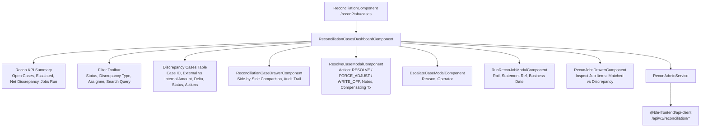

# Sprint 5 Task 3 (S5-T3): External Reconciliation Case Explorer Implementation Plan

> **For Claude:** REQUIRED SUB-SKILL: Use superpowers:executing-plans to implement this plan task-by-task.
>
> **Back-Office Console: Settlement & Reconciliation (FR-OPS-RECON-02)**  
> **Target App:** `apps/admin-console` (Angular 19 Standalone, Signals, Zoneless)  
> **Route:** `/recon` (Tab: `cases`) and query param `?tab=cases`

---

## 1. Goal Description

Implement the **External Reconciliation Case Explorer** (FR-OPS-RECON-02) in `apps/admin-console`. This feature equips back-office bank operations teams and compliance officers to:

1. **Review and monitor reconciliation discrepancy cases:** Query open and historical discrepancy cases (`GET /api/v1/reconciliation/cases`) arising from automated clearing file comparisons.
2. **Compare mismatched transactions side-by-side:** Inspect discrepancy records comparing expected external clearing amounts against internal double-entry ledger postings with computed variance deltas and currency validation.
3. **Execute administrative resolution actions:** Resolve cases (`POST /api/v1/reconciliation/cases/{id}/resolve`) via actions (`RESOLVE`, `FORCE_ADJUST`, `WRITE_OFF`, `MANUAL_CLEAR`) with required audit rationale and optional compensating transaction references.
4. **Escalate & Assign cases:** Escalate urgent or high-value discrepancies to senior operations/compliance (`POST /api/v1/reconciliation/cases/{id}/escalate`) and assign cases to operators (`POST /api/v1/reconciliation/cases/{id}/assign`).
5. **Inspect & trigger reconciliation jobs:** Monitor batch clearing reconciliation jobs (`GET /api/v1/reconciliation/external/jobs`), trigger on-demand jobs (`POST /api/v1/reconciliation/external/jobs`), and inspect item-level match status (`GET /api/v1/reconciliation/external/jobs/{id}/items`).
6. **Activate Tab 2 in `ReconciliationComponent`:** Replace the staged placeholder card with `<ble-reconciliation-cases-dashboard />`.

---

## 2. Architecture & Reactive Data Flow

---

## 3. Scope of Implementation

### In Scope
- `ReconAdminService` with Angular 19 signals (`cases`, `jobs`, `selectedCase`, `selectedJob`, `jobItems`, `kpis`, filters).
- `ReconciliationCasesDashboardComponent` (KPI header, toolbar, cases table, jobs sub-view, modal toggles).
- `ReconciliationCaseDrawerComponent` (side-by-side ledger vs. clearing record comparison, delta indicator, audit trail).
- `ResolveCaseModalComponent` (resolution actions: `RESOLVE`, `FORCE_ADJUST`, `WRITE_OFF`, `MANUAL_CLEAR`, mandatory notes, compensating transaction).
- `EscalateCaseModalComponent` (escalation reason, operator attribution).
- `RunReconJobModalComponent` (source rail, statement reference, date, currency).
- `ReconJobsDrawerComponent` (inspection of reconciliation jobs & item match details).
- Integration into `ReconciliationComponent` (replacing placeholder under `tab === 'cases'`).
- 100% comprehensive unit tests for service, modals, drawer, and dashboard components.

### Out of Scope
- Backend modifications (backend endpoints already generated in `@ble-frontend/api-client`).
- Dead-Letter Queue (DLQ) operations (Sprint 5 Task 4).

---

## 4. Atomic Action Items

### Task 1: State Management (`ReconAdminService`)
- Create `apps/admin-console/src/features/recon/services/recon-admin.service.ts`
- Implement signals: `cases`, `jobs`, `selectedCase`, `selectedJob`, `jobItems`, `loading`, `mutating`, `error`.
- Implement computed: `filteredCases`, `kpiSummary`.
- Implement API actions: `loadCases`, `loadJobs`, `getCaseById`, `resolveCase`, `escalateCase`, `assignCase`, `runJob`, `loadJobItems`.
- Create unit test `apps/admin-console/src/features/recon/services/recon-admin.service.spec.ts`.

### Task 2: Modals & Drawers
- Create `apps/admin-console/src/features/recon/components/reconciliation-case-drawer.component.ts` & test.
- Create `apps/admin-console/src/features/recon/components/resolve-case-modal.component.ts` & test.
- Create `apps/admin-console/src/features/recon/components/escalate-case-modal.component.ts` & test.
- Create `apps/admin-console/src/features/recon/components/run-recon-job-modal.component.ts` & test.
- Create `apps/admin-console/src/features/recon/components/recon-jobs-drawer.component.ts` & test.
- Create `apps/admin-console/src/features/recon/components/index.ts` barrel.

### Task 3: Dashboard Assembly & Reconciliation Hub Integration
- Create `apps/admin-console/src/features/recon/reconciliation-cases-dashboard.component.ts` & test.
- Update `apps/admin-console/src/features/recon/reconciliation.component.ts` to embed the new dashboard.
- Update `apps/admin-console/src/features/recon/reconciliation.component.spec.ts`.
- Export from `apps/admin-console/src/features/recon/index.ts`.

### Task 4: Verification & Validation
- Run `pnpm nx test admin-console` to ensure all unit tests pass.
- Run `pnpm nx typecheck admin-console` to ensure zero TypeScript errors.
- Run `pnpm nx build admin-console` to verify production bundling.
- Format with Prettier.

---

## 5. Execution Handoff Choice

Plan complete and ready for execution. Two execution options:
1. **Direct Session Execution:** Implement step-by-step in this session with immediate test validation and git commits.
2. **Subagent-Driven Execution:** Execute each task in sequence.
