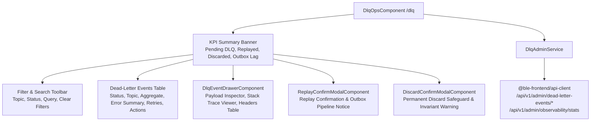

# Sprint 5 Task 4 (S5-T4): Dead-Letter Queue (DLQ) Ops Console Implementation Plan

> **For Claude:** REQUIRED SUB-SKILL: Use superpowers:executing-plans to implement this plan task-by-task.
>
> **Back-Office Console: Audit Trail & DLQ Ops (FR-OPS-AUDIT-02)**  
> **Target App:** `apps/admin-console` (Angular 19 Standalone, Signals, Zoneless)  
> **Route:** `/dlq`

---

## 1. Goal Description

Implement the **Dead-Letter Queue (DLQ) & Broker Diagnostics Console** (FR-OPS-AUDIT-02) in `apps/admin-console`. This feature equips back-office site reliability engineers (SREs), system administrators, and financial operations teams to:

1. **Monitor dead-lettered events and broker health:** Fetch and inspect failed transactional outbox messages and unroutable broker events (`GET /api/v1/admin/dead-letter-events` and `GET /api/v1/admin/observability/stats`).
2. **Diagnose delivery failures with root-cause traces:** Display failure error messages, exception stack traces, retry counts vs. max retry limits, and exact event timestamps.
3. **Inspect event payloads & headers:** Slide-over drawer providing formatted JSON payload inspection with one-click clipboard copying and transport headers inspection (trace ID, correlation ID, event type).
4. **Trigger manual event replay:** Safely re-queue failed events into the event broker pipeline (`POST /api/v1/admin/dead-letter-events/{id}/retry`) individually or in bulk.
5. **Discard unrecoverable events:** Mark corrupted or poisoned messages as permanently discarded (`DELETE /api/v1/admin/dead-letter-events/{id}`) with administrative confirmation.
6. **Integrate into existing `/dlq` route:** Upgrade the existing stub `DlqOpsComponent` into a production-grade operations console.

---

## 2. Architecture & Reactive Data Flow

---

## 3. Scope of Implementation

### In Scope
- `DlqAdminService` with Angular 19 signals (`events`, `selectedEvent`, `observabilityStats`, `kpiSummary`, `filteredEvents`, filters).
- `DlqEventDrawerComponent` (error callout, full stack trace with copy, formatted JSON payload inspector, headers breakdown).
- `ReplayConfirmModalComponent` (individual and bulk replay confirmation).
- `DiscardConfirmModalComponent` (permanent purge/discard confirmation with invariant checks).
- `DlqOpsComponent` (full high-density dashboard assembly replacing the placeholder).
- `apps/admin-console/src/features/dlq/index.ts` barrel.
- Comprehensive unit test suites for all created components and services.

### Out of Scope
- Backend modifications (backend endpoints already generated in `@ble-frontend/api-client`).
- E2E Playwright test suite (Sprint 5 Task 5).

---

## 4. Atomic Action Items

### Task 1: State Management (`DlqAdminService`)
- Create `apps/admin-console/src/features/dlq/services/dlq-admin.service.ts`
- Signals: `events`, `selectedEvent`, `observabilityStats`, `loading`, `mutating`, `error`, `statusFilter`, `topicFilter`, `searchQuery`.
- Computed: `filteredEvents`, `kpiSummary`.
- Methods: `loadEvents`, `loadObservabilityStats`, `replayEvent`, `discardEvent`, `selectEvent`, filter setters.
- Create unit test `apps/admin-console/src/features/dlq/services/dlq-admin.service.spec.ts`.

### Task 2: Modals & Drawer Components
- Create `apps/admin-console/src/features/dlq/components/dlq-event-drawer.component.ts` & test.
- Create `apps/admin-console/src/features/dlq/components/replay-confirm-modal.component.ts` & test.
- Create `apps/admin-console/src/features/dlq/components/discard-confirm-modal.component.ts` & test.
- Create `apps/admin-console/src/features/dlq/components/index.ts` barrel.

### Task 3: Dashboard Assembly (`DlqOpsComponent`)
- Upgrade `apps/admin-console/src/features/dlq/dlq-ops.component.ts` with complete UI:
  - Header actions: Refresh, Replay All Pending.
  - KPI summary row (Pending, Replayed, Discarded, Outbox Lag).
  - Multi-column filter toolbar (Status, Topic, Search Query).
  - High-density data table with row actions (Inspect, Replay, Discard).
  - Integrated modals & drawer.
- Create unit test `apps/admin-console/src/features/dlq/dlq-ops.component.spec.ts`.
- Create `apps/admin-console/src/features/dlq/index.ts` barrel.

### Task 4: Verification & Quality Assurance
- Run `pnpm nx test admin-console` to ensure 100% test pass rate across the full suite.
- Run `pnpm nx typecheck admin-console` to verify zero TypeScript errors.
- Run `pnpm nx build admin-console` to verify production bundle generation.
- Format with Prettier.
