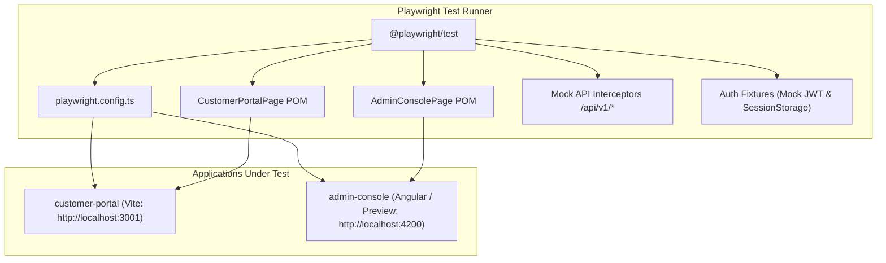

# Sprint 5 Task 5 (S5-T5): Playwright E2E Integration Test Suite Implementation Plan

> **For Claude:** REQUIRED SUB-SKILL: Use superpowers:executing-plans to implement this plan task-by-task.
>
> **E2E Integration Test Suite: Multi-Role Customer & Admin Console Journeys**  
> **Target Apps:** `apps/customer-portal` (React 19, Vite, TanStack Query) & `apps/admin-console` (Angular 19 Standalone, Signals, Zoneless)  
> **Testing Framework:** `@playwright/test` (Chromium, Multi-WebServer, Mock API Route Interceptors, Page Object Models)

---

## 1. Goal Description

Implement an automated, deterministic **End-to-End (E2E) Integration Test Suite** using Playwright for the Banking Ledger Engine Frontend monorepo. The suite validates core multi-role user journeys across both applications:

1. **Customer Portal Journeys (`apps/customer-portal`):**
   - User authentication and session management.
   - Intra-bank transfer execution with atomic posting assertions.
   - Client-side idempotency preservation on retry (BR-F03) and 409 conflict handling.
   - Quick-action cash operations (Deposit / Withdrawal modals).

2. **Admin Console Journeys (`apps/admin-console`):**
   - Back-office RBAC enforcement (`roleGuard` restricting customer roles and unauthorized access).
   - High-density account directory search, filtering, and sorting.
   - Account lifecycle state transitions (Freeze, Unfreeze, Close modals).
   - Settlement batch creation, settlement execution, and record inspection drawer.
   - Reconciliation discrepancy triage and resolution workflow.
   - Dead-Letter Queue (DLQ) inspection, stack trace viewing, replay, and discard safeguards.

---

## 2. Architecture & Testing Strategy

### Key Design Principles:

- **Fast & Deterministic:** Tests run against production-built or lightweight dev web servers with zero external backend dependencies. Network traffic is intercepted at the Playwright browser level (`page.route('**/api/v1/**', ...)`), guaranteeing sub-second test execution without network flakes.
- **Robust Selectors:** Tests leverage established `data-testid` attributes present across both applications (e.g. `data-testid="transfer-submit-btn"`, `data-testid="action-freeze-{id}"`).
- **Page Object Models (POM):** Encapsulate UI interactions and assertions cleanly, shielding tests from underlying DOM structure changes.
- **Contract Fidelity:** Mock payloads and HTTP headers strictly match OpenAPI schemas from `@ble-frontend/api-client` and `@ble-frontend/domain-types`.

---

## 3. Scope of Implementation

### In Scope

- Install `@playwright/test` and required browser runtime in the monorepo.
- `playwright.config.ts` configured with two test projects (`customer-portal` and `admin-console`), parallelization, and webServer lifecycle management.
- Test infrastructure in `e2e/`:
  - `e2e/fixtures/jwt-tokens.ts`: Realistic JWT generator for `CUSTOMER`, `OPERATOR`, `AUDITOR`, and `ADMIN` roles.
  - `e2e/fixtures/mock-data.ts`: Shared mock entities (Accounts, Transfers, Batches, Cases, DLQ events).
  - `e2e/fixtures/api-router.ts`: Route interceptor handlers for all `/api/v1/*` endpoints.
- Page Object Models:
  - `e2e/pages/customer-portal.page.ts`
  - `e2e/pages/admin-accounts.page.ts`
  - `e2e/pages/admin-settlement-recon.page.ts`
  - `e2e/pages/admin-dlq.page.ts`
- E2E Test Specs:
  - `e2e/customer-transfer-flow.spec.ts`
  - `e2e/admin-account-lifecycle.spec.ts`
  - `e2e/admin-settlement-recon.spec.ts`
  - `e2e/admin-dlq-ops.spec.ts`
- Monorepo integration:
  - Add `"test:e2e"` script to root `package.json`.
  - Update `nx.json` / project configurations if appropriate.

### Out of Scope

- Sprint 5 Task 6 (Production build optimization & Docker containerization).

---

## 4. Atomic Action Items

### Task 1: Playwright Installation & Monorepo Configuration

- Install `@playwright/test` via `pnpm add -D @playwright/test`.
- Run `pnpm exec playwright install chromium` to fetch the Chromium browser binary.
- Create root `playwright.config.ts` specifying:
  - Multi-project setup: `customer-portal` (baseURL `http://localhost:3001`), `admin-console` (baseURL `http://localhost:4200`).
  - WebServer options to automatically serve both applications.
  - Headless execution with screenshot and video recording on failure.
- Add npm scripts to `package.json`: `"test:e2e": "playwright test"`.

### Task 2: Auth Fixtures, Mock Data & API Route Interceptors

- Create `e2e/fixtures/jwt-tokens.ts`:
  - Utilities to generate valid base64 mock JWT tokens with `CUSTOMER`, `OPERATOR`, `ADMIN` roles and future expiration timestamps.
- Create `e2e/fixtures/mock-data.ts`:
  - Realistic mock accounts (`acc-eur-001`, `acc-usd-002`, `acc-gbp-003`).
  - Mock settlement batches and records (`batch-sepa-001`).
  - Mock reconciliation discrepancy cases (`rc-case-001`).
  - Mock DLQ dead-letter events (`dlq-evt-001`).
- Create `e2e/fixtures/api-router.ts`:
  - Playwright route interception helper to automatically wire default and scenario-specific responses for `/api/v1/*`.

### Task 3: Page Object Models (POMs)

- Create `e2e/pages/customer-portal.page.ts`:
  - Methods: `navigate()`, `injectSession()`, `submitTransfer()`, `expectTransferSuccess()`, `triggerRetry()`, `openDepositModal()`.
- Create `e2e/pages/admin-accounts.page.ts`:
  - Methods: `navigate()`, `injectSession()`, `search()`, `filterByStatus()`, `triggerFreeze()`, `triggerUnfreeze()`, `expectAccountStatus()`.
- Create `e2e/pages/admin-settlement-recon.page.ts`:
  - Methods: `navigateSettlements()`, `navigateReconCases()`, `openCreateBatchModal()`, `submitCreateBatch()`, `settleBatch()`, `openCaseDrawer()`, `resolveCase()`.
- Create `e2e/pages/admin-dlq.page.ts`:
  - Methods: `navigate()`, `expectKpis()`, `openEventDrawer()`, `triggerReplay()`, `triggerDiscard()`.

### Task 4: Test Specification Implementation

- Create `e2e/customer-transfer-flow.spec.ts`:
  - Test 1: Complete transfer successfully and assert new reference and balance update.
  - Test 2: Transient 409 conflict displays DomainErrorBanner and retry preserves same idempotency key.
  - Test 3: Deposit quick-action modal completes successfully.
- Create `e2e/admin-account-lifecycle.spec.ts`:
  - Test 1: Role guard denies unauthenticated/customer users.
  - Test 2: Table filter and sort updates displayed accounts.
  - Test 3: Freeze account modal prompts for reason and updates status badge to FROZEN.
  - Test 4: Unfreeze account modal completes and updates status badge to ACTIVE.
- Create `e2e/admin-settlement-recon.spec.ts`:
  - Test 1: Settlement dashboard renders KPI summary and batch table.
  - Test 2: Create batch modal validates and appends new batch.
  - Test 3: Settle batch triggers mutation and success toast.
  - Test 4: Recon tab opens discrepancy drawer and resolves case with resolution notes.
- Create `e2e/admin-dlq-ops.spec.ts`:
  - Test 1: DLQ ops console renders observability KPIs and events table.
  - Test 2: Inspect event drawer opens with formatted JSON payload and headers.
  - Test 3: Replay event confirmation triggers retry mutation.
  - Test 4: Discard event confirmation safely removes message.

### Task 5: Verification & Quality Gates

- Execute `pnpm test:e2e` and verify all tests pass cleanly.
- Verify unit tests across the monorepo remain 100% passing (`pnpm test`).
- Verify TypeScript types (`pnpm typecheck`).
- Format with Prettier (`pnpm format`).
